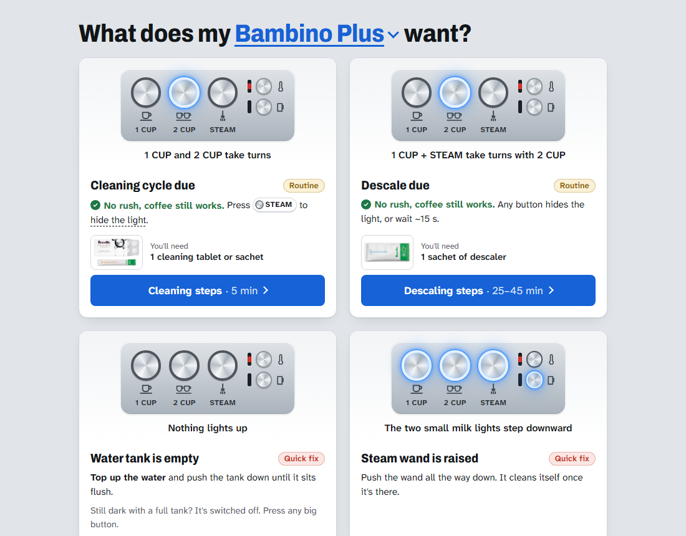
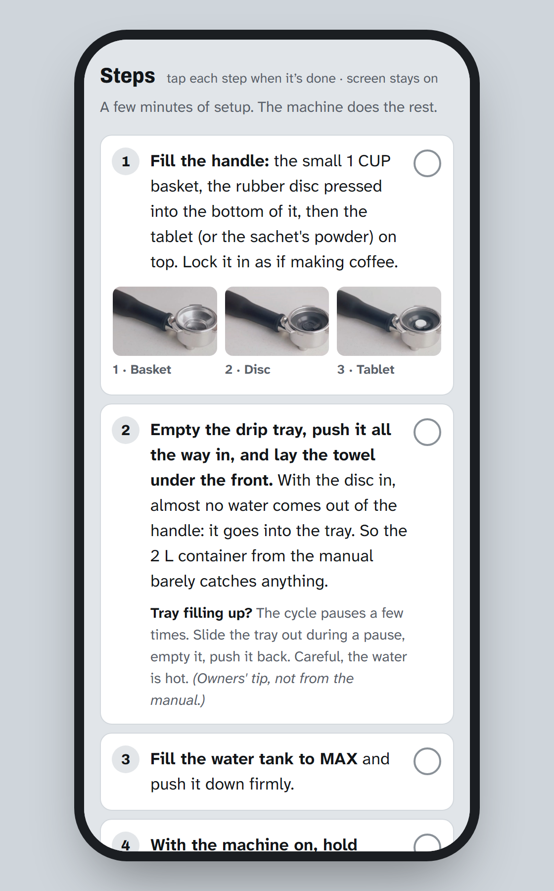

# What does my Bambino want?

Your Breville / Sage Bambino is flashing and you don't remember what it means. Find the pattern, get calm step-by-step instructions: cleaning cycle, descale, empty tank, blocked steam wand.

**Live site: https://romanshevchuk.github.io/what-my-bambino-wants/**

<p>
  
  
</p>

- Works for the **Bambino (BES450 / SES450)** and **Bambino Plus (BES500 / SES500)**.
- Every step is checked against Breville's manuals. Owner tips are marked as such.
- Tick off steps as you go, and the phone screen stays on during a 25-minute descale.

Spotted a mistake, or does your machine behave differently? [Open an issue](https://github.com/romanshevchuk/what-my-bambino-wants/issues).

## Run locally

A static site with no build step. Serve the folder and open it, for example:

```
python -m http.server 8765
```

then visit http://localhost:8765/.

## Structure

- `index.html`: the pages and guide content
- `css/styles.css`: styles
- `js/app.js`: navigation, model switching, step progress, theme
- `img/`: product photos, icons, link preview image
- `docs/`: README screenshots

Unofficial fan project, not affiliated with Breville or Sage.
